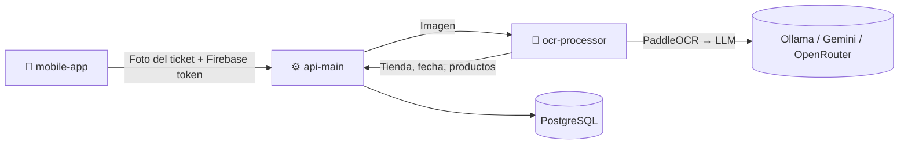

# Lumen

**Lumen** es una app móvil de finanzas personales que registra tus tickets de compra. Haces una foto al ticket y la IA extrae la tienda, la fecha y los productos con sus precios, para que puedas seguir en qué gastas.

## Repositorios

| Repo | Descripción | Stack |
|---|---|---|
| [**api-main**](https://github.com/Lumen-app-mobile/api-main) | API REST: usuarios, transacciones, categorías, etiquetas y balance | Go, chi, GORM, PostgreSQL, Redis, Firebase Auth |
| [**ocr-processor**](https://github.com/Lumen-app-mobile/ocr-processor) | Extracción de datos de tickets con OCR + LLM | Python, Flask, PaddleOCR, Ollama / Gemini / OpenRouter |
| [**mobile-app**](https://github.com/Lumen-app-mobile/mobile-app) | App móvil para escanear tickets y consultar gastos | Expo, React Native, NativeWind, Firebase |
| [**landing-page**](https://github.com/Lumen-app-mobile/landing-page) | Web de presentación y descarga | Astro, Tailwind CSS |
| [**docs**](https://github.com/Lumen-app-mobile/docs) | Memoria del proyecto, diseño y documentación de la API | Markdown |

## Autores

- Jhonny Vicmar Claure
- Adrià Martínez Morales
